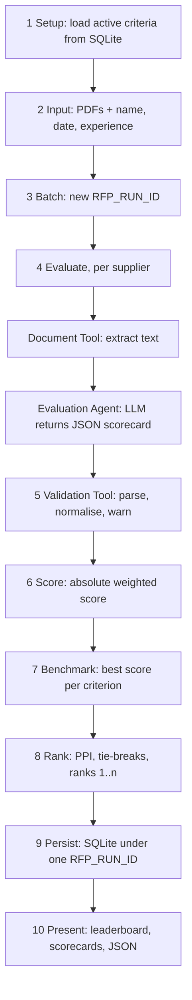

# Agentic RFP Evaluation and Supplier Ranking

An AI-assisted Streamlit application that reads supplier RFP responses (PDF), scores each one against
configurable criteria stored in SQLite, benchmarks suppliers against their peers, and produces an
explainable, deterministic leaderboard.

**The core rule:** the LLM only *judges proposal content* (a score, justification and evidence quote per
criterion). All arithmetic, benchmarking, tie-breaks and ranking are plain Python in `rfp_eval/ranking.py`.
Given the same validated scorecards, the output is always identical.

* **Live app:** `<paste your Streamlit Community Cloud URL here>`
* **Screenshots:** see [Screenshots](#screenshots) (to be added after you run the app)

---

## 1. Quick start

```bash
python -m venv .venv && source .venv/bin/activate      # Windows: .venv\Scripts\activate
pip install -r requirements.txt
python scripts/seed_db.py                               # optional: the app also creates + seeds the DB on first start
streamlit run app.py
```

Then, in the browser:

1. Sidebar: choose **Offline mock** (no key needed) or **Anthropic / OpenAI-compatible** and supply a key.
2. Tab **2**: upload the four PDFs from `sample_rfps/`, fix the supplier names / dates / experience ratings, click **Evaluate suppliers**.
3. Tab **3**: leaderboard, detailed scorecards, run details and JSON download.

> **About the offline mock.** It is a transparent keyword-indicator heuristic (`rfp_eval/mock_provider.py`), *not* a
> language model. It exists so the whole pipeline can be run, tested and demoed without an API key, and so the sample
> export is reproducible. Use a real provider for genuine evaluations.

### Configuring a real LLM

Either type the key in the sidebar (session only), or set secrets / environment variables
(see `.streamlit/secrets.toml.example`):

| Provider | Variables |
|---|---|
| Anthropic | `ANTHROPIC_API_KEY`, optional `ANTHROPIC_MODEL` (default `claude-sonnet-5-5`) |
| OpenAI-compatible (OpenAI, Groq, Gemini's OpenAI endpoint, Ollama...) | `OPENAI_API_KEY`, optional `OPENAI_BASE_URL`, `OPENAI_MODEL` |
| Default provider | `RFP_PROVIDER` = `anthropic` / `openai` / `mock` / `mock_faulty` |

Any model that can return JSON works; no provider-specific features (tool calling, structured-output modes) are required.

### Deploying to Streamlit Community Cloud

1. Push this folder to a **public GitHub repository** (do not commit `.streamlit/secrets.toml`; it is git-ignored).
2. On <https://share.streamlit.io> choose **Create app**, select the repo, branch, and `app.py` as the main file.
3. Under **Advanced settings > Secrets** paste, for example:
   ```toml
   RFP_PROVIDER = "anthropic"
   ANTHROPIC_API_KEY = "sk-ant-..."
   ```
   (Or leave secrets empty: visitors can still use the offline mock, or enter their own key in the sidebar.)
4. Deploy and put the public URL at the top of this README.

Note: Community Cloud's filesystem is ephemeral, so the SQLite file (and run history) resets when the app restarts.
The schema and criteria are re-created automatically on start-up.

---

## 2. Folder structure

```
app.py                         Streamlit UI (4 tabs)
rfp_eval/
  config.py                    paths and tunables
  db.py                        SQLite schema, seed data, persistence
  pdf_tool.py                  Document Tool: PDF -> clean text (PyMuPDF, pypdf fallback)
  prompts.py                   builds the evaluation prompt from the active criteria
  llm.py                       provider clients (Anthropic, OpenAI-compatible, mock)
  mock_provider.py             offline heuristic "LLM" + deliberately faulty mode
  validation.py                Validation Tool: parse, normalise, clip, impute, warn
  ranking.py                   Ranking Tool: formulas, benchmarks, PPI, tie-breaks, ranks
  orchestrator.py              Orchestrator Agent: runs the workflow, collects warnings + trace
scripts/
  seed_db.py                   create/seed the database (--reset to start over)
  generate_sample_pdfs.py      regenerate the four synthetic supplier PDFs
  make_sample_export.py        regenerate sample_output/*.json
sample_rfps/                   4 fictional supplier proposals (2 pages each)
sample_output/                 exported JSON of a completed run (+ one with validation warnings)
tests/                         50 pytest tests
```

## 3. Architecture and data flow



| Component | File | Uses LLM? | Responsibility |
|---|---|---|---|
| Orchestrator Agent | `orchestrator.py` | no | Calls the tools in order, retries bad JSON once, never lets one failed supplier sink the run, records an agent trace |
| Document Tool | `pdf_tool.py` | no | Extract and clean text; reject invalid, encrypted or image-only PDFs; truncate oversized text with a warning |
| Evaluation Agent | `prompts.py` + `llm.py` | **yes** | Judge one proposal against the active criteria; cite verbatim evidence |
| Validation Tool | `validation.py` | no | Schema checks, fill missing criteria, clip invalid scores, check evidence against the source text |
| Ranking Tool | `ranking.py` | no | All formulas, benchmarks, PPI, tie-breaks and rank assignment |

Prompt design (`prompts.py`): the model is told to use only evidence in the document, return one result per
active criterion, stay inside the score range, quote evidence verbatim, output JSON only, and treat the document as
untrusted (ignore instructions embedded in it). **Criterion weights are deliberately not shown to the model**, and
criteria are injected from the database on every run, so changing criteria never needs a code change.

## 4. Formulas

For supplier *s*, criterion *c* with weight *w<sub>c</sub>*, max score *M<sub>c</sub>*, score *x<sub>sc</sub>*:

| Metric | Formula |
|---|---|
| Absolute weighted score | `sum_c (x_sc / M_c) * w_c`  (0-100 when weights total 100) |
| Criterion benchmark | `max_s x_sc` over valid scores (placeholders for missing results are not valid scores) |
| Criterion gap | `x_sc - benchmark_c`  (0 for the leader, otherwise negative) |
| Relative performance % | `x_sc / benchmark_c * 100`; **if benchmark is 0 the value is 100** (everyone is tied for best) |
| Peer Performance Index (PPI) | `sum_c relative_pct_sc * w_c / sum_c w_c` |

**Tie-break order** (then ranks 1, 2, 3... are assigned after one stable sort):

1. Higher PPI
2. Earlier submission date
3. Higher historical experience rating
4. Supplier name ascending (case-insensitive)

PPI is rounded to 6 decimals *for sorting only*, so floating-point noise can never change an ordering. The run
details screen explains, for every adjacent pair, which rule decided their order.

### Worked example (from `sample_output/sample_run.json`, Apex Systems)

| Criterion | Weight | Score | Benchmark | Gap | Relative % | Weighted points (abs.) | PPI points |
|---|---|---|---|---|---|---|---|
| Technical Capability | 30 | 9.5 | 9.5 | 0.0 | 100.0 | 28.5 | 30.0 |
| Implementation Plan | 20 | 6.0 | 10.0 | -4.0 | 60.0 | 12.0 | 12.0 |
| Commercial Value | 20 | 5.5 | 10.0 | -4.5 | 55.0 | 11.0 | 11.0 |
| Security & Compliance | 20 | 8.5 | 8.5 | 0.0 | 100.0 | 17.0 | 20.0 |
| Support & Experience | 10 | 7.0 | 10.0 | -3.0 | 70.0 | 7.0 | 7.0 |
| **Total** | 100 | | | | | **75.5** | **80.0** |

Final sample leaderboard (offline mock provider): 1. NexaWorks (abs 85.0, PPI 88.38), 2. Apex Systems (75.5, 80.0),
3. Orbit Digital (42.5, 43.89), 4. BrightPath Tech (33.0, 33.33).
Absolute score and PPI can order suppliers differently; PPI is the official ranking metric, absolute score is shown alongside.

## 5. Validation rules (all produce visible warnings)

| Situation | Behaviour |
|---|---|
| JSON wrapped in markdown fences or prose | Extracted automatically |
| Unparseable / empty reply | One retry with a corrective note; then the supplier is marked **failed** (scores 0, loud warning) |
| Criterion missing from the reply | Score 0, status `imputed` |
| Non-numeric / NaN / boolean score | Score 0, status `imputed` (`"7/10"` and `"8"` are accepted) |
| Score above max or below 0 | Clipped to the range, status `clipped` |
| Model used a different `max_score` | Rescaled to the database max (e.g. 80/100 becomes 8/10), status `rescaled` |
| Unknown or duplicate criterion id | Unknown ignored; duplicates keep the first; name used as fallback match |
| Evidence not found verbatim in the document | Flagged "not verified" (informational; the score is never silently changed) |
| Score > 0 with no evidence | Warning |

Run status is `COMPLETED`, `COMPLETED_WITH_WARNINGS`, or `FAILED`. Input validation in the UI blocks the Evaluate
button for: fewer than two PDFs, unreadable/image-only PDFs, blank or duplicate supplier names, missing dates, ratings
outside 0-10, and active weights that do not total 100%.

## 6. SQLite design

| Table | Fields |
|---|---|
| `evaluation_criteria` | `criterion_id`, `name`, `description`, `weight`, `max_score`, `is_active` |
| `rfp_runs` | `rfp_run_id`, `created_at`, `status`, plus `provider`, `model`, `criteria_snapshot`, `warnings_json`, `tie_break_json` |
| `supplier_results` | `rfp_run_id`, `supplier_name`, `submission_date`, `experience_rating`, `absolute_score`, `ppi`, `final_rank`, `result_json` |

Each run stores a **snapshot of the criteria used**, so old runs stay explainable after criteria are edited.
Results are written in a single transaction. Criteria can be edited in the UI (Criteria tab) or directly in SQLite.

## 7. Exported JSON

`sample_output/sample_run.json` contains: `rfp_run_id`, `created_at`, `status`, `provider`, `model`, `criteria`
(snapshot), `tie_break_rules`, `benchmarks`, `suppliers` (ranked; each with absolute score, PPI, rank and per-criterion
score, benchmark, gap, relative %, weight, justification, evidence, validation status), `tie_break_explanations`,
`warnings`, and `agent_trace`. `sample_run_with_validation_warnings.json` is the same run through the deliberately
malformed mock so you can see the 16 recorded validation warnings.

## 8. Synthetic RFP documents

Four fictional proposals for the same request ("RFP-2026-017: Enterprise Order-to-Cash Integration Platform"), each
with an executive summary, solution, timeline/team/milestones, price table with assumptions, security section and
support/experience/references. All names, prices and references are invented.

| Supplier | Profile | Price (3 yrs) | Schedule |
|---|---|---|---|
| Apex Systems | Strong technical design and security; higher price | INR 480 lakh | 9 months |
| BrightPath Tech | Lowest price, fast; weak compliance detail, limited experience | INR 210 lakh | 5 months |
| NexaWorks | Balanced; strongest implementation plan and support model | INR 340 lakh | 7 months |
| Orbit Digital | Strong experience and references; vague integration plan | INR 320 lakh | 8 months |

Regenerate with `python scripts/generate_sample_pdfs.py`.

## 9. Testing

```bash
pip install pytest
python -m pytest -q          # 50 tests
```

Covered: hand-calculated formulas, zero-benchmark handling, every tie-break level, input-order independence,
float-noise immunity, weight validation, JSON parsing and every normalisation rule, PDF edge cases (corrupt, empty,
image-only), end-to-end run with persistence, repeatability, dynamic criteria reloaded per run, partial and total
failure handling, retry behaviour, and input validation.

## 10. Suggested demo script (one success + validation/error cases)

1. **Success:** provider *Offline mock* (or your real LLM), upload the four sample PDFs, set dates/ratings, Evaluate. Show the leaderboard, open a scorecard and an evidence expander, open *Run details* (tie-break explanation, trace), click *Download JSON*.
2. **UI validation:** upload one PDF only, or give two suppliers the same name, or enter a rating of 11: errors appear and Evaluate is disabled. Upload a non-text/scanned PDF: a clear extraction error appears.
3. **Criteria validation:** on tab 1 change a weight so the total is not 100%: the error shows and evaluation is blocked. Click *Scale active weights to total 100%*.
4. **LLM output validation:** choose *Offline mock - deliberately malformed output*, run again: the run completes with warnings listing the clipped, imputed and ignored results.
5. **Tie-break:** give two suppliers identical content/PDFs with different submission dates; the run details explain the order.
6. **Dynamic criteria:** deactivate a criterion, rebalance to 100%, re-run: the prompt and scorecards use only active criteria.

## 11. Assumptions and design decisions

* A zero benchmark yields relative performance 100% (all suppliers tied at zero); this avoids division by zero without penalising anyone.
* Missing/invalid results are scored 0 and flagged rather than dropping the supplier, so every supplier is always ranked and every warning is visible.
* A supplier that cannot be evaluated at all (unreadable PDF, provider error, no valid JSON after retry) stays in the table as `failed` with zero scores; if *every* supplier fails the run is marked `FAILED` and nothing is ranked.
* The database `max_score` is authoritative; the model's reported `max_score` is only used to rescale.
* Experience rating is a 0-10 number entered by the user; submission date is a calendar date.
* Text is truncated to 60,000 characters per document (with a warning); OCR for scanned PDFs is out of scope.
* LLM calls are made sequentially at temperature 0 (where the model accepts it). LLM scoring is still not perfectly repeatable between runs; determinism is guaranteed for everything after validation.

## 12. Known limitations

* The live-provider code paths (`AnthropicClient`, `OpenAICompatClient`) are small wrappers but were **not exercised against live APIs** while building this; run one real evaluation with your key before submitting.
* Screenshots and the deployed URL have to be added by you (they cannot be produced without running and deploying the app).
* No authentication or multi-user separation: runs are visible to everyone using the same deployment.

## Screenshots

Add PNGs to a `docs/` folder and reference them here, e.g. ``:
Criteria tab, Supplier input with a validation error, Leaderboard, Detailed scorecard, Run details.
